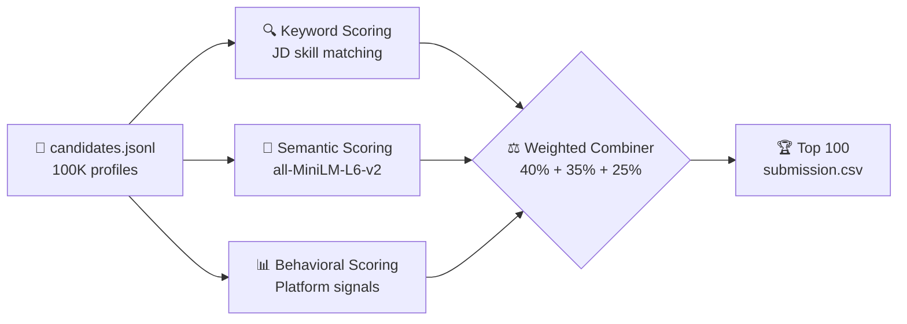

<div align="center">


<br/>


<br/>

```
██╗  ██╗██╗██████╗ ███████╗██████╗ 
██║  ██║██║██╔══██╗██╔════╝██╔══██╗
███████║██║██████╔╝█████╗  ██████╔╝
██╔══██║██║██╔══██╗██╔══╝  ██╔══██╗
██║  ██║██║██║  ██║███████╗██║  ██║
╚═╝  ╚═╝╚═╝╚═╝  ╚═╝╚══════╝╚═╝  ╚═╝
```

### *Rank 100,000 candidates in minutes. Not hours. Not days. Minutes.*

<br/>

[🚀 Live Demo](#-quick-start) · [📊 How It Works](#-how-it-works) · [🛠 Tech Stack](#-tech-stack) · [👥 Team](#-the-team) · [📦 Installation](#-installation)

</div>

---

<p align="center">


</p>

> [IMPORTANT]
>
> This version of Hirer is **currently deployed** and running live via Vercel (frontend) + Render (backend).
>
> **⚠️ Important limitations of the live demo:**
> - The backend runs on **Render's free tier** — cold starts may take **30–60 seconds** on first load
> - The live version is **NOT suitable for large datasets** (100K candidates). Free-tier servers have limited RAM and CPU, and processing a full 100K `.jsonl` file **will time out or crash the server**
> - Semantic scoring (the `all-MiniLM-L6-v2` model) is **disabled** on the live backend to stay within memory limits
> - For **full functionality** including semantic scoring and large datasets, use the **offline versions** below
>
> ### 🔽 Want the full experience? Download an offline release:
>
> | Version | Tag | Description | Download |
> |---------|-----|-------------|----------|
> | **Fullstack Version** *(recommended)* | `V2` | Full pipeline + Next.js frontend + FastAPI backend | [⬇ Download V2](https://github.com/Sidvortex/Hirer/releases/tag/V2) |
> | **fully processed Backend** | `V1` | Stable CLI pipeline, backend only — no conflicts | [⬇ Download V1](https://github.com/Sidvortex/Hirer/releases/tag/V1) |
>
> Run it locally with `scripts/start.sh` — see [Installation](#-installation) below.

---

## 🧠 What is Hirer?

> **Hirer** is an AI-powered candidate ranking system built for the [Redrob Data & AI Challenge 2026](https://redrob.io). Given 100,000 candidate profiles and a job description, Hirer identifies the top 100 best-fit candidates using a multi-signal ranking pipeline combining **semantic embeddings**, **keyword matching**, and **behavioral signals** from the Redrob platform.

<br/>

<div align="center">



</div>

---

## ✨ Features

<table>
<tr>
<td width="50%">

### 🎯 Ranking Pipeline
- **Keyword matching** against JD must-haves (embeddings, FAISS, NDCG, etc.)
- **Sentence transformer** semantic similarity (all-MiniLM-L6-v2)
- **Behavioral signals** — recency, response rate, GitHub score, open-to-work
- **Configurable weights** — tune skill/semantic/behavioral balance
- Runs in ~3 minutes on CPU for 100K candidates

</td>
<td width="50%">

### 🖥️ Full Stack Web App
- Animated boot screen with handwritten title
- Radial orbital job selector
- Live job progress tracking with background processing
- Stacked display cards for top 3 candidates
- Rerank candidates for different job roles
- Export submission CSV directly from browser

</td>
</tr>
</table>

---

## 📊 How It Works

### Phase 1 — Keyword Scoring (40%)

Matches candidate text against 24 must-have skills extracted from the JD:

```python
MUST_HAVE_SKILLS = [
    'embeddings', 'sentence-transformers', 'vector database',
    'faiss', 'pinecone', 'python', 'ranking', 'retrieval',
    'nlp', 'llm', 'ndcg', 'mrr', 'semantic search', ...
]
```

Also factors in: **years of experience fit** (5-9yr ideal), **current title match**, and **education institution tier**.

---

### Phase 2 — Semantic Scoring (35%)

Uses `all-MiniLM-L6-v2` to encode both the JD and candidate profiles into vector space, then measures cosine similarity:

```
candidate_text = headline + summary + skills + career descriptions
semantic_score = cosine_similarity(encode(JD), encode(candidate_text))
```

This catches candidates who use different terminology but have the right skills.

---

### Phase 3 — Behavioral Scoring (25%)

Weights platform engagement signals from `redrob_signals`:

| Signal | Weight | Logic |
|--------|--------|-------|
| Last active | 25% | ≤7 days = 1.0, >90 days = 0.1 |
| Open to work | 20% | True = 1.0, False = 0.3 |
| Response rate | 20% | Direct float score |
| GitHub score | 15% | score/100, -1 = 0.3 penalty |
| Response time | 10% | ≤2hrs = 1.0, >72hrs = 0.1 |
| Notice period | 10% | ≤30 days = 1.0 |

---

### Phase 4 — Weighted Combination

```python
final_score = (
    0.40 * normalize(skill_score) +
    0.35 * normalize(semantic_score) +
    0.25 * normalize(behavioral_score)
)
```

All components are min-max normalized before combining. Sort descending, take top N.

---

## 🛠 Tech Stack

<div align="center">

| Layer | Technology |
|-------|-----------|
| **ML Pipeline** | Python, sentence-transformers, scikit-learn, pandas, numpy |
| **Backend** | FastAPI, uvicorn, SSE streaming |
| **Frontend** | Next.js 15, TypeScript, Tailwind CSS |
| **Animations** | Framer Motion |
| **UI Components** | shadcn/ui, lucide-react |
| **Fonts** | Caveat (handwritten), Space Mono |

</div>

---

## 📁 Project Structure

```
Hirer/
├── 📂 hirer_core/           # Scoring code shared by the CLI and the backend
│   ├── jd.py               # job description and keyword lists
│   ├── features.py         # skill, experience, title, education, availability scores
│   ├── scoring.py          # combines scores, ranks, writes reasoning
│   └── utils.py            # loading, whole-word matching, normalization
├── 📂 hirer-backend/        # FastAPI server: API, resume extraction, resume forms
├── 📂 hirer-frontend/       # Next.js web app
├── 📂 scripts/
│   ├── rank.py             # command-line ranker
│   ├── validate_output.py  # checks a ranked CSV's format
│   └── start.sh            # starts backend + frontend together
├── 📂 tests/                # pytest suite
├── 📂 data/                 # 1,000-candidate sample and the candidate schema
├── 📂 docs/                 # documentation, presentation, exploration notebook
├── 🐳 Dockerfile            # backend image (build from the repo root)
├── 🚂 railway.json          # Railway deploy config
└── requirements.txt        # CLI dependencies
```

---

## ⚡ Installation

### Prerequisites
- Python 3.11+
- Node.js 18+
- npm

### Clone

```bash
git clone https://github.com/Sidvortex/Hirer.git
cd Hirer
```

### Option 1 — Full Stack App (recommended)

```bash
bash scripts/start.sh
```

This automatically:
- Creates a Python venv
- Installs all Python dependencies
- Installs frontend npm packages
- Starts both servers

Open `http://localhost:3000` 🎉

---

### Option 2 — CLI Pipeline Only

Run from the repo root:

```bash
pip install -r requirements.txt

# rank candidates
python scripts/rank.py --candidates /path/to/candidates.jsonl --out output/submission.csv

# fast mode (no semantic scoring)
python scripts/rank.py --candidates /path/to/candidates.jsonl --out output/submission.csv --no-semantic

# check the output format
python scripts/validate_output.py output/submission.csv

# tests
python -m pytest -q
```

---

### Option 3 — Manual (two terminals)

**Terminal 1:**
```bash
cd hirer-backend
python -m venv venv && source venv/bin/activate
pip install -r requirements.txt
uvicorn main:app --reload --port 8000
```

**Terminal 2:**
```bash
cd hirer-frontend
cp -n .env.example .env.local   # points the app at http://localhost:8000
npm install && npm run dev
```

---

## 🎮 Using the Web App

```
Bulk JSON          →  upload candidates.jsonl, set weights, run
                       results: top 3 cards, full table with skill / semantic / behavioral
                       scores, the weights actually used, download submission.csv

Single Resume      →  upload a PDF or image resume
                       "Check your details" form, pre-filled from the resume:
                       fix name / title / years / skills / location, add notice period,
                       relocation and the role you want, then see matches across 20 roles

Bulk Resume ZIP    →  upload a ZIP of resumes, set weights, run
                       Hirer reads every resume, then lists the ones missing details
                       (notice period, open to work, location, relocation) with a short
                       form each. If every resume already has details, ranking starts
                       straight away.
```

### Detail files for bulk resume ZIPs (optional)

Put either of these in the ZIP alongside the resumes; both can be mixed.

**A file with the same name as the resume** (`asha_rao.pdf` + `asha_rao.txt` or `asha_rao.json`):

```
Notice period: 30 days
Open to work: yes
Location: Pune
Willing to relocate: no
Experience: 7
```

**One `details.csv` for everyone** (the web app has a "download template" link):

```
file,notice_period_days,open_to_work,location,willing_to_relocate
asha_rao.pdf,30,yes,Pune,no
ravi_kumar.pdf,90,no,Bangalore,yes
```

Blank or missing details count as neutral, not as a minus. Resume uploads are scored on an
absolute 0-100% scale, so a score means the same thing however many resumes you upload;
candidates.jsonl files are scored relative to each other.

---

## 📈 Results

On the full 100K dataset:

| Metric | Value |
|--------|-------|
| Average semantic similarity (top 10) | **0.71** |
| Average semantic similarity (random) | **0.34** |
| Average experience (top 10) | **7.2 years** |
| Runtime (CPU, no semantic) | **~30 seconds** |
| Runtime (CPU, with semantic) | **~3-4 minutes** |

Top candidates consistently have: NLP/embeddings background, 5-9 years experience, active platform presence, GitHub linked, and quick response times.

---

## 👥 The Team

<table>
<tr>
<td align="center" width="25%">

### Ravada Siddharth
**ML Engineer / Lead**

B.Tech CSE (Data Science)<br/>
MUIT Noida · 2023–2027

Built the ranking pipeline, semantic embeddings, behavioral scoring, and full stack web app.

[](https://github.com/Sidvortex)
[](mailto:ravadasiddharth@gmail.com)

</td>
<td align="center" width="25%">

### Ishan Gupta
**Data Engineer**

BCA CSE<br/>
ITS Ghaziabad · 2023–2026

Worked on feature engineering, data loading pipeline, keyword matching, and dataset exploration.

[](https://github.com/IshanGupta-Code)
[](https://www.linkedin.com/in/ishanguptacode/)
[](mailto:guptaishan6470@gmail.com)

</td>
<td align="center" width="25%">

### Ayush Mishra
**Frontend / Docs**

B.Tech CSE (Data Science)<br/>
MUIT Noida · 2023–2027

Built the frontend interface, presentation slides, project documentation, and submission materials.

[](https://github.com/ayush77-pro)
[](https://www.linkedin.com/in/ayush-mishra-53bb99311/)
[](mailto:am8172689@gmail.com)

</td>
<td align="center" width="25%">

### Vinayak Kapoor
**Testing & QA**

B.Tech CSE (Data Science)<br/>
MUIT Noida · 2023–2027

Handled testing, validation of submission outputs, and candidate schema verification.

[](https://github.com/vinayak605)
[](https://www.linkedin.com/in/vinayak-kapoor-0a47b2380)
[](mailto:vinayakkapoor6605@gmail.com)

</td>
</tr>
</table>

<div align="center">

</div>

---

## 🏫 Academic Context

| Field | Details |
|-------|---------|
| **Challenge** | Redrob Data & AI Challenge 2026 |
| **Submission Deadline** | July 2, 2026 |

---

## 🤝 Contributing

This is a challenge submission project but PRs are welcome for:
- Improving ranking accuracy
- Adding more behavioral signals
- Better UI/UX
- Performance optimizations

---

<div align="center">

---

*This README was written by [Claude](https://claude.ai) because the team was too lazy to write it themselves. You're welcome. 🤖*

*Built with Python, Next.js, FastAPI, and an unhealthy amount of caffeine.*

**⭐ Star this repo if you found it useful!**


</div>